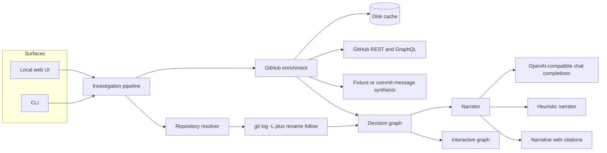

# git-archaeologist

Ask why a line or function exists. git-archaeologist follows `git log -L` through renames and moves, attaches the commits to pull requests, reviews, issues, and discussions, and builds a decision graph. A narrator — an OpenAI-compatible model, or a deterministic heuristic when you have no key — writes the answer and cites every artifact.

It runs offline. The bundled sample repository and GitHub fixture need no token, and the test suite refuses outbound network calls.

## Quickstart

Requires Node.js 22+ and git.

```bash
npm install
npm test
npm run build
node dist/cli.js demo
node dist/cli.js serve
```

Open [http://127.0.0.1:4317](http://127.0.0.1:4317) and choose **Excavate the sample repository**. The UI stays on loopback: the page can read any repository the process can see.

Ask your own tree:

```bash
node dist/cli.js investigate \
  --repo . \
  --file src/narrative/heuristic.ts \
  --symbol narrateHeuristic \
  --offline
```

A GitHub URL is cloned into the cache directory (this needs network, and a `GITHUB_TOKEN` if the repo is private):

```bash
node dist/cli.js investigate \
  --repo https://github.com/org/name \
  --file src/app.ts \
  --line 42 \
  --question "Why does this guard exist?"
```

Copy `.env.example` to `.env` when you want live GitHub data or a model. Empty values are safe to commit; do not put real tokens in `.env.example`.

## Architecture



| Piece | Role |
| --- | --- |
| `src/git/trace.ts` | `git log -L` for the line or symbol range, then `git log --follow --name-status` for renames. Revert commits are detected from `This reverts commit …`. |
| `src/git/symbol.ts` | Finds a function by declaration and walks braces (skipping strings and same-line type literals) or Python indentation. |
| `src/github/enrich.ts` | Parses `#12`, `(#40)`, `Fixes #12`, and `discussion #3`. Live mode calls the GitHub API. Offline mode uses a fixture when the origin matches, otherwise synthesizes stubs from the text. |
| `src/cache/disk-cache.ts` | SHA-256 file cache for GitHub and LLM responses, with a TTL. |
| `src/graph/build.ts` | Decision graph. |
| `src/narrative/` | Heuristic narrator, or `POST {LLM_BASE_URL}/chat/completions`. Model output that misses a citation gets the missing tokens appended. |
| `public/` | Loopback UI: force-directed graph, citation chips, dossier. |

## Decision graph

Nodes:

| Type | Id | Meaning |
| --- | --- | --- |
| `focus` | `focus` | The line or symbol you asked about. |
| `commit` | `commit:<sha>` | A commit that introduced the line, modified it, moved the file, or was reverted. |
| `pull_request` | `pr:<n>` | A pull request linked from a commit message, the fixture, or `GET /commits/{sha}/pulls`. |
| `issue` | `issue:<n>` | An issue named by a commit or pull request. |
| `discussion` | `discussion:<id>` | A review comment, review body, issue comment, or GitHub Discussion. |

Edges:

| Edge | Meaning |
| --- | --- |
| `introduced` | This commit added the line. Points at the focus. |
| `modified` | This commit changed the line later. Points at the focus. |
| `reverted` | This commit reverts that commit. |
| `motivated-by` | A commit or pull request names an issue or discussion as the reason. A follow-up whose message says "review" also points at review comments on the same pull request. |
| `linked` | Structural membership: commit in a pull request, comment on a pull request or issue, or a rename sitting next to the line history. |

Citation tokens in the narrative are stable and clickable in the UI: `[@commit:<sha>]`, `[@pr:<n>]`, `[@issue:<n>]`, `[@discussion:<id>]`.

## Example

`node dist/cli.js demo` excavates a deterministic sample history:

1. **1 Jan 2024** — Mina adds a null guard in `lib/session.ts` (`Fixes #12`, pull request 40).
2. **1 Feb 2024** — The reason string becomes `missing-or-expired` after Ada's review.
3. **1 Mar 2024** — The file moves to `src/auth/session.ts`.
4. **1 Apr 2024** — Jonas reverts the wording because the dashboard matcher keys on `missing-token` (issue 15, pull request 44).
5. **1 May 2024** — Expiry comes back as `token.expired` without changing the reason string (issue 18, pull request 51).

The sample's `origin` is `https://github.com/acme/widget`, which selects `fixtures/github/acme-widget.json`. That repository is fictional.

```text
This is about `refreshSession` in `src/auth/session.ts`. Its current text, `if (token == null || token.expired || !token.value) return { ok: false, reason: "missing-token" };`, was set on 1 May 2024 by [@commit:6363f5925fdd0aca9e48ef1ba20c8d0a6e40ce83] (Mina Ellison), whose message says “Restore expired-token coverage (#51)”. That change names [@issue:18] (“Expired tokens still take the refresh path”) as its motive. It landed through [@pr:51] (“Cover expired tokens without changing the reason”).

On 1 Jan 2024, [@commit:cd15b2a9dcf6b64206e238d7e0174e50a069fc27] introduced the line: “Add session refresh guard (#40)”. Afterwards it read `if (token == null) return { ok: false, reason: "missing-token" };`. On 1 Feb 2024, [@commit:2d18fc1c46d4196f3a78ab8569540cfe9acc39fa] modified the line: “Broaden the guard after review (#40)”. Afterwards it read `if (token == null) return { ok: false, reason: "missing-or-expired" };`. On 1 Mar 2024, [@commit:7243fcf8b5a14c472b437b8f24696e51684dcfde] moved `lib/session.ts` to `src/auth/session.ts` (“Move session module into auth/”). On 1 Apr 2024, [@commit:a7eda5056691b69e33da90841018fd521209e042] modified the line: “Revert "Broaden the guard after review (#40)"”. Afterwards it read `if (token == null) return { ok: false, reason: "missing-token" };`. This reverts [@commit:2d18fc1c46d4196f3a78ab8569540cfe9acc39fa] (“Broaden the guard after review (#40)”). On 1 May 2024, [@commit:6363f5925fdd0aca9e48ef1ba20c8d0a6e40ce83] modified the line: “Restore expired-token coverage (#51)”. Afterwards it read `if (token == null || token.expired || !token.value) return { ok: false, reason: "missing-token" };`.
```

The machine-readable report (`--json`) is the same story plus the graph. Decision edges from the demo include:

```text
introduced   cd15b2a Add session refresh guard (#40)     →  refreshSession
modified     2d18fc1 Broaden the guard after review     →  refreshSession
reverted     a7eda50 Revert "Broaden the guard…"        →  2d18fc1 Broaden the guard after review
modified     6363f59 Restore expired-token coverage     →  refreshSession
motivated-by cd15b2a                                    →  issue #12
motivated-by 2d18fc1                                    →  Ada's review comment
motivated-by a7eda50                                    →  issue #15
motivated-by 6363f59                                    →  issue #18
```

Commit ids above are stable: the sample builder pins author, committer, and timestamps.

## CLI

```text
git-archaeologist investigate --repo <path|url> --file <path> (--line <n> | --symbol <name>) [--end <n>] [--question <text>] [--offline] [--json] [--fixture <id|path>]
git-archaeologist demo [--json]
git-archaeologist serve [--port 4317] [--host 127.0.0.1]
```

`--line` traces that line (and `--end` widens it to a range). `--symbol` finds the declaration and traces the whole body. Passing both keeps the line range and records the symbol as the focus label. Paths are relative to the repository root and cannot contain `..`.

## Configuration

| Variable | Purpose |
| --- | --- |
| `GITHUB_TOKEN` | Live pull requests, reviews, issue comments, and Discussions. Omit it and referenced numbers are synthesized, or filled from a fixture. |
| `GITHUB_API_URL` | GitHub Enterprise API root. Default `https://api.github.com`. |
| `LLM_BASE_URL` | OpenAI-compatible origin, no `/chat/completions` suffix. Example: `https://api.openai.com/v1`. |
| `LLM_API_KEY` | Sent as `Authorization: Bearer`. |
| `LLM_MODEL` | Default `gpt-4o-mini`. |
| `GIT_ARCHAEOLOGIST_OFFLINE` | `1` skips GitHub and the model. |
| `GIT_ARCHAEOLOGIST_CACHE_DIR` | Default `$XDG_CACHE_HOME/git-archaeologist` or `~/.cache/git-archaeologist`. |
| `GIT_ARCHAEOLOGIST_FIXTURE` | `acme/widget` or a path to fixture JSON. |

Offline behavior:

- `--offline` or `GIT_ARCHAEOLOGIST_OFFLINE=1` never calls `fetch`.
- If the repository origin is `github.com/acme/widget`, or you pass `--fixture`, the bundled fixture supplies titles, bodies, reviews, and discussion threads.
- Any other repository still produces a graph: `#12` becomes a synthetic issue, `(#40)` a synthetic pull request, and the heuristic explains that the details were not fetched.
- With a key and without `--offline`, the model writes the narrative. If the request fails, the heuristic result is returned and the warning says so.

GitHub responses and model completions are cached on disk for 24 hours. A second identical model call does not hit the network again.

## Web UI

`git-archaeologist serve` serves `public/` and three JSON routes:

- `GET /api/config` — whether a token and a model key are present. Values are booleans, never the secrets.
- `POST /api/demo` — builds the sample repository in the cache and investigates it offline.
- `POST /api/investigate` — `{ "repo", "file", "line" | "symbol", "question", "offline" }`.

The graph is drawn in SVG with a small force layout. Drag a node, scroll to zoom, drag the background to pan, and filter edges. Citation chips in the field report select the same node as the dossier list.

## Development

```bash
npm test          # vitest, fully offline
npm run build     # tsc to dist/
node dist/cli.js demo --json
```

Tests build a throwaway git history, assert that blame follows the rename, that the revert edge points at the reverted commit, that every graph node is cited, that the GitHub client caches, and that the HTTP UI can excavate the sample. `tests/setup.ts` rejects any `fetch` that is not to `127.0.0.1`.

GitHub Actions (`.github/workflows/ci.yml`) runs the tests, the TypeScript build, and `node dist/cli.js demo --json`, then checks that the demo graph contains `introduced`, `modified`, `motivated-by`, and `reverted`.

## Roadmap

- Ask why a line was **deleted**, not only why the current text exists.
- Cache blame traces between runs so a second question in the same file skips `git log`.
- GitLab and Bitbucket providers behind the same enrichment interface.
- Search discussions when a commit does not name an issue number.
- A small editor bridge that sends the current selection to the loopback UI.
- Show whether the cited commits were signed.

## License

MIT. See [LICENSE](LICENSE).
